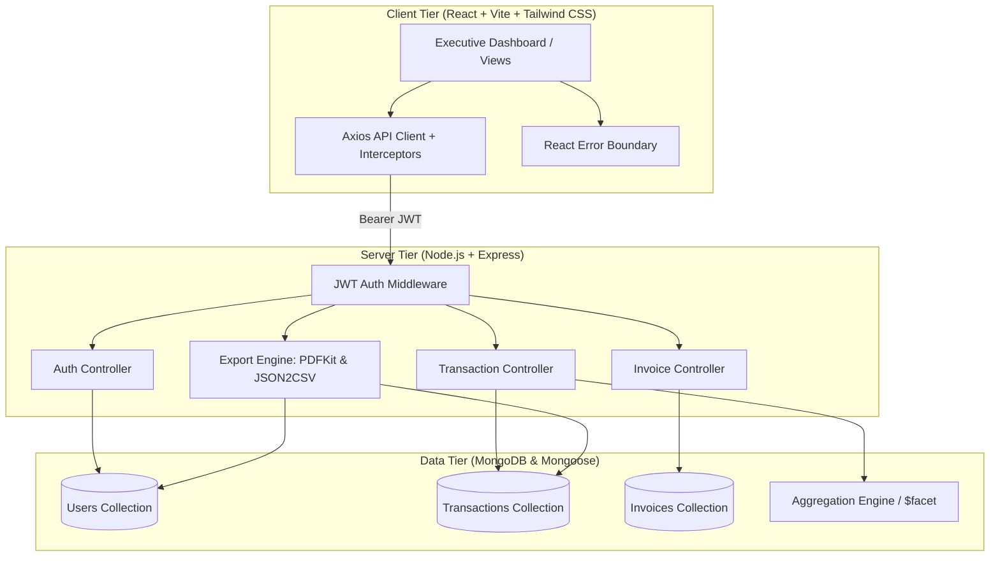

# Project No. 5: B2B Expense Tracker & Invoice Dashboard

A modern, full-stack B2B financial management application and executive dashboard. Built for businesses, agencies, and independent consultancies to track operational cash flows, reconcile client invoicing, monitor category distributions, and generate audit-ready financial statements in PDF and CSV.

---

## 🌟 Key Features

- **Multi-Tenant JWT Authentication**: Secure user registration, password hashing via `bcryptjs` salt rounds, and token-based API authentication.
- **Executive Analytics Dashboard**:
  - Live cash flow KPIs: Total Income, Total Expenses, Net Balance, Active Invoices.
  - Interactive **Recharts** Composed Chart (Bar & Line toggles) for monthly revenue vs. burn rate trends.
  - Dynamic Doughnut Chart for categorized expense breakdowns with percentage-of-total distribution.
  - Annual and all-time query filters with instant recalculation.
- **Transaction Ledger**:
  - Full CRUD for income and expense streams.
  - Multi-parameter filtering by type (`income`/`expense`), category, and date ranges.
  - Real-time tabular audit view with directional indicators.
- **Invoicing & Accounts Receivable**:
  - Multi-line invoice generator with real-time subtotal and total calculations.
  - Status lifecycle management (`Draft`, `Sent`, `Paid`, `Overdue`).
  - Automatic invoice due date scheduling.
- **Server-Side File Export Engine**:
  - **PDF Reports**: Formatted statements built on-the-fly using `pdfkit`, featuring KPI summary boxes, zebra-striped transaction tables, auto-pagination, and account metadata.
  - **CSV Exports**: Formatted spreadsheets compiled with `json2csv` for accounting and spreadsheet ingestion.
- **Resilient Frontend UX**:
  - Global `ErrorBoundary` wrapper with diagnostic stack traces and retry states.
  - Skeleton loaders and zero-data empty state illustrations across all pages.

---

## 🏗️ System Architecture



---

## 🛠️ Tech Stack Breakdown

### Frontend
- **React 19** & **Vite**: Ultra-fast build pipeline and modern component architecture.
- **Tailwind CSS**: Clean, responsive design with customized typography and UI states.
- **Recharts**: Responsive SVG-based charting library powering cash-flow and doughnut breakdowns.
- **Axios**: HTTP client configured with request/response interceptors for token attachment and 401 handling.
- **Lucide React**: Clean icons throughout the interface.

### Backend
- **Node.js** & **Express**: RESTful API server with modular routing and structured middleware.
- **MongoDB** & **Mongoose**: Document database utilizing schema validation, hooks, and multi-stage aggregation pipelines.
- **JWT (jsonwebtoken)** & **bcryptjs**: Stateless authentication and cryptographic password hashing.
- **PDFKit**: Server-side vector document compiler for PDF reports.
- **JSON2CSV**: Standardized comma-separated values serializer.

---

## 💡 Key Technical Challenges Solved

### 1. Unified Multi-Stage MongoDB Aggregation via `$facet`
Traditional analytics often require running 3 to 4 sequential queries to compute global summaries, category breakdowns, and temporal trendlines. In `controllers/transactionController.js`:
- Used a single `$facet` pipeline stage that branches simultaneously into:
  - `summary`: Computes `$sum` for income, expenses, transaction count, and calculates `netBalance` using `$subtract`.
  - `categoryBreakdown`: Groups amounts by category and sorts descending.
  - `monthlyTrends`: Groups transactions by `{ year: { $year: '$date' }, month: { $month: '$date' } }`, builds formatted periods (`YYYY-MM`), and sorts chronologically.
- Enforced strict `new mongoose.Types.ObjectId(req.user.id)` casting at the `$match` boundary to ensure proper index utilization.
- Built graceful fallbacks so users with zero records receive normalized empty structures rather than null pointer errors.

### 2. High-Performance Server-Side File Streaming
Exporting large financial datasets shouldn't strain server RAM:
- **PDFKit**: Rather than creating intermediate PDF files on disk, reports are piped directly into the Express response stream (`doc.pipe(res)`), reducing disk I/O to zero.
- Dynamic page-boundary calculations detect when `currentY` exceeds margin limits (`currentY + rowHeight > 760`), dynamically invoking `doc.addPage()` and re-rendering headers.
- **CSV Engine**: Converted on-the-fly and streamed with `Content-Type: text/csv` and RFC-compliant `Content-Disposition` headers.

### 3. Strict JWT Multi-Tenant User Isolation
- Enforced user-level data segregation across all controllers:
  - Transaction retrieval, updates, deletions, and invoice queries check `{ _id: id, user: req.user.id }`.
  - Aggregation match stages and export engines strictly constrain queries to `req.user.id`.
  - Authorization middleware validates bearer tokens, handles token expirations, and binds the verified identity to `req.user`.

---

## 📂 Project Structure

```
B2B-Expense-tracker/
├── .env.example              # Template environment variables
├── README.md                 # Complete system documentation
├── server/
│   ├── controllers/
│   │   ├── authController.js        # User registration, login, profile
│   │   ├── transactionController.js # Transaction CRUD & $facet analytics
│   │   ├── invoiceController.js     # Invoice management & lifecycle
│   │   └── exportController.js      # PDF & CSV file generators
│   ├── middleware/
│   │   └── auth.js                  # JWT verification middleware
│   ├── models/
│   │   ├── User.js                  # User schema with bcrypt pre-save hook
│   │   ├── Transaction.js           # Transaction model with validations
│   │   └── Invoice.js               # Invoice model with subdocuments
│   ├── routes/
│   │   ├── authRoutes.js            # /api/auth endpoints
│   │   ├── transactionRoutes.js     # /api/transactions endpoints
│   │   ├── invoiceRoutes.js         # /api/invoices endpoints
│   │   └── exportRoutes.js          # /api/export endpoints
│   ├── server.js                    # Express app configuration & DB init
│   └── package.json
└── client/
    ├── src/
    │   ├── components/
    │   │   ├── ErrorBoundary.jsx    # React Error Boundary wrapper
    │   │   ├── SummaryCards.jsx     # KPI metric display cards
    │   │   ├── ExpenseChart.jsx     # Recharts Composed Bar/Line chart
    │   │   └── CategoryPieChart.jsx # Recharts Doughnut breakdown
    │   ├── pages/
    │   │   ├── Dashboard.jsx        # Executive analytics dashboard
    │   │   ├── Transactions.jsx     # Transaction ledger & modal form
    │   │   └── Invoices.jsx         # Invoice manager & line item builder
    │   ├── services/
    │   │   └── api.js               # Axios instance with auth interceptors
    │   ├── App.jsx                  # Main shell with tab navigation
    │   ├── main.jsx                 # Application entry point
    │   └── index.css                # Tailwind directives
    ├── tailwind.config.js
    ├── vite.config.js
    └── package.json
```

---

## 🚀 Local Setup & Installation

### Prerequisites
- [Node.js](https://nodejs.org/) (v18.0.0 or higher)
- [MongoDB](https://www.mongodb.com/) (running locally on port 27017 or a MongoDB Atlas URI)

### 1. Clone the Repository
```bash
git clone https://github.com/your-username/b2b-expense-tracker.git
cd b2b-expense-tracker
```

### 2. Configure Environment Variables
Create a `.env` file at the root or inside `/server`:
```bash
cp .env.example .env
```
Ensure the variables are set:
```env
PORT=5000
MONGO_URI=mongodb://localhost:27017/b2b-expense-tracker
JWT_SECRET=your_super_secret_jwt_key_here
```

### 3. Server Setup & Database Seeding
```bash
cd server
npm install

# Run database seeder to populate sample data:
npm run seed
# Or: node seed/seedData.js (use --dry-run for offline schema validation)

npm run dev
```
The server will boot at `http://localhost:5000`. You can test health via `GET http://localhost:5000/api/health`.

### Test Account Credentials (from seeder)
- **Email**: `test@freelancer.com`
- **Password**: `password123`

### 4. Client Setup
In a new terminal window:
```bash
cd client
npm install
npm run dev
```
The Vite development server will start at `http://localhost:5173`.

---

## 📡 API Reference Overview

| Method | Endpoint | Description | Protected |
| :--- | :--- | :--- | :---: |
| `GET` | `/api/health` | Service uptime and health check | No |
| `POST` | `/api/auth/register` | Register new user account | No |
| `POST` | `/api/auth/login` | Authenticate and obtain JWT token | No |
| `GET` | `/api/auth/me` | Fetch authenticated user profile | Yes |
| `GET` | `/api/transactions` | Query transactions (filters: `type`, `category`, dates) | Yes |
| `POST` | `/api/transactions` | Create income or expense record | Yes |
| `PUT` | `/api/transactions/:id` | Update transaction by ID | Yes |
| `DELETE` | `/api/transactions/:id` | Remove transaction by ID | Yes |
| `GET` | `/api/transactions/analytics` | MongoDB `$facet` aggregation analytics | Yes |
| `GET` | `/api/invoices` | List invoices (filter: `status`) | Yes |
| `POST` | `/api/invoices` | Generate new invoice with line items | Yes |
| `PUT` | `/api/invoices/:id` | Update invoice details or status | Yes |
| `DELETE` | `/api/invoices/:id` | Remove invoice by ID | Yes |
| `GET` | `/api/export/csv` | Download transactions as CSV file | Yes |
| `GET` | `/api/export/pdf` | Download formatted statement as PDF file | Yes |

---

## 🌐 Live Demo & Deployment

- [Live URL](https://b2b-expense-tracker.vercel.app/) 
- **Demo Credentials**:
  - Email: `test@freelancer.com`
  - Password: `password123`

---

## 📄 License
MIT © 2026. Built with precision for the B2B Expense Tracker project.
